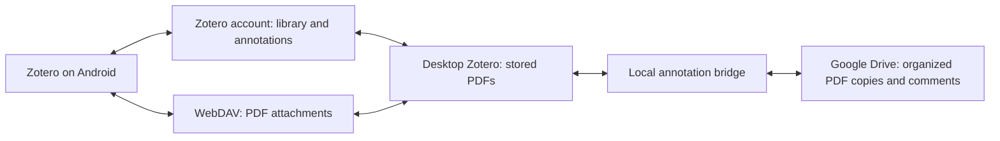

# Zotero, with an organized Google Drive library

**Just the steps? Start with the [quick setup guide (TL;DR)](QUICKSTART.md).**

I wanted to collect and annotate papers in Zotero, open them on my phone, and
still browse a Drive folder full of sensibly named, annotated PDFs. This
repository puts that workflow together with a small Zotero add-on and
MIT-licensed scripts.

**Use Zotero as your everyday reference manager.** Add papers there, read and
annotate them on your computers or Android, and let the bridge maintain the
organized Drive copies. You can also comment on those copies in Drive's PDF
preview; supported comments return to Zotero as PDF annotations.

The folder layout follows publication order:

```text
F. LastAuthorSurname/
└── 2024-FirstAuthorSurname-AnExamplePaperTitle.pdf
```

The folder uses the **last author's first initial and surname**, such as
`N. Miolane`. The filename uses the year, the **first author's surname**, and
the title in PascalCase. A saved author map keeps initials, full first names,
and optional middle names together when the match is unambiguous.
[How author folders are matched](docs/author-folders.md).

## What everyday use looks like

1. Save a reference and its PDF anywhere in **My Library**. The bridge watches
   the whole personal library, including items in nested collections or no
   collection. A paper in several collections still gets one copy per attachment.
2. Keep the PDF as a **stored attachment** in Zotero. Fill in its title, date,
   and authors so the Drive copy can be named correctly.
3. Read and annotate in desktop Zotero or Zotero for Android. Native Zotero
   sync carries the reference and annotations between devices; WebDAV carries
   the attachment files.
4. Leave the computer running the bridge signed into GNOME and keep Zotero
   open. Every five minutes, it updates the organized Drive copies and imports
   supported Drive preview comments.
5. For an immediate refresh, sync Zotero, then choose **Tools → Sync Drive PDF
   annotations now**. Check **Tools → Drive PDF sync status** afterward.

The import from your previous reference manager happens once. New additions
there are not continuously copied into Zotero. After migration, collect new
papers in Zotero and keep the original export as an archive.

## How the pieces fit together

There are two kinds of sync here. Understanding that distinction makes setup
and troubleshooting much easier.



Zotero sync carries references, collections, notes, and native annotations.
Attachment files travel through Zotero Storage or WebDAV. This setup uses
Koofr's WebDAV service while keeping the organized copies in Drive.
[Zotero's sync documentation](https://www.zotero.org/support/sync) explains the
two services.

Zotero stores its annotations in its database. The bridge exports PDFs with
those annotations embedded so they can be read outside Zotero. It also reads
Drive comment threads and converts supported positions into native Zotero PDF
annotations. Changes to mapped comment bodies can travel back to Drive.
[Why Zotero stores annotations this way](https://www.zotero.org/support/kb/annotations_in_database).

The code and Zotero are open source. Google Drive and Koofr's hosted service
are proprietary. An existing compatible WebDAV server, including Nextcloud,
can replace Koofr.

## Before starting

This is a **Linux/GNOME workflow targeting Zotero 7**, tested on Zotero 7.0.22.
The manifest intentionally limits installation to Zotero 7.0.x. Other operating
systems and Zotero major versions need adaptation and testing.

You need:

- Zotero with stored PDF attachments in **My Library**.
- A writable Google Drive destination, connected through GNOME Online Accounts.
- Python 3.11 or newer. The system Python needs PyGObject/GIO; a virtual
  environment supplies the PDF library.
- A Zotero account and either Zotero Storage or WebDAV for other devices.
- Node.js 22 to run the JavaScript tests; the running bridge does not need Node.

Keep Zotero's database in its normal local location. The Drive folder contains
exported PDFs. Disable ZotMoov's automatic moving so working attachments remain
stored in Zotero and can sync to Android.

**Already have this workflow running?** Continue using Zotero. Keep the ignored
`config.local.json`, `.state/`, and `output/` directories, which hold the local
configuration and file mappings. Skip the one-time migration steps. Updating
source files or building an XPI does not install it automatically.

## 1. Prepare the checkout

Clone or download this repository, then run these commands from its root.
On Debian/Ubuntu, the usual system packages are:

```sh
sudo apt install python3-venv python3-gi gvfs-backends gnome-online-accounts
/usr/bin/python3 -m venv .venv
.venv/bin/python -m pip install -r requirements.txt
/usr/bin/python3 scripts/setup.py init
```

Other distributions need equivalent packages for Python, GIO, GVfs Google
Drive support, and GNOME Online Accounts. `init` creates an ignored local
configuration and input directory, leaving any existing configuration intact.

## 2. Connect the Drive destination

In **GNOME Settings → Online Accounts**, add the Google account and enable file
access. Open its Drive entry in Files so GVfs mounts it.
[GNOME's account setup instructions](https://help.gnome.org/gnome-help/accounts-add.html).

Create a destination folder for the organized copies. Open it in Files and
press **Ctrl+L** to copy its `google-drive://…` location. To list mounted account
roots and their local paths, run:

```sh
/usr/bin/python3 scripts/list_drive_mounts.py
```

Edit the ignored `config.local.json`:

| Setting | What to enter |
| --- | --- |
| `collection_name` | Collection used only for the one-time import/repair, such as `Research`; routine sync watches all of My Library |
| `destination_drive_uri` | GNOME URI of the folder for organized PDF copies |
| `pdf_python` | Usually `.venv/bin/python` |
| `desktop_python` | Usually `/usr/bin/python3`, with GIO installed |
| `poll_minutes` | Refresh interval; defaults to `5` |

Credentials come from the GNOME account and stay in memory. Enter Zotero and
WebDAV passwords directly in Zotero's settings; never add them to this file.

Check the runtime without changing any papers:

```sh
/usr/bin/python3 scripts/setup.py doctor
```

Run this from the logged-in GNOME desktop session. For migration inputs and
source-folder settings, use the next step.

## 3. Bring an existing library across once

The included bootstrap starts from an export of an existing reference library.
Follow the separate [one-time migration guide](docs/migration.md) to import
references, recover stored PDFs and embedded annotations, and publish the first
verified Drive copies. It also creates the initial file registry the bridge
needs. Installing the add-on alone does not initialize that registry. Routine
sync then watches all of My Library, independently of the import collection.

If you already completed that migration, skip it. Keep your existing collection
and local state. For routine operation, use Zotero and the bridge's sync menu.

## 4. Install the automatic bridge

Build the local package and print the Zotero launcher commands:

```sh
/usr/bin/python3 scripts/setup.py build
/usr/bin/python3 scripts/setup.py commands
```

In Zotero, open **Tools → Developer → Run JavaScript** and check **Run as async
function**. Run the printed **`install_drive_bridge`** command. The other printed
commands are for the one-time migration; do not rerun them for everyday sync.

The installer sets the project location and installs the locally built XPI.
No account details or library files are bundled in the XPI. It also disables
ZotMoov automatic moving to keep the working PDFs syncable.

Keep the checkout and configured Python environment at their current paths.
After moving the checkout or changing runtime settings, rebuild and run the
generated installer again. Keep the source files and private state together.

This is a local add-on with no hosted update service. Its manifest uses the
reserved HTTPS hostname `updates.invalid` because the tested Zotero build
requires a secure update URL. The installer disables automatic upgrades for
this add-on. Update by reviewing source changes, rebuilding, and running the
generated installer. See [Zotero's plugin documentation](https://www.zotero.org/support/dev/zotero_7_for_developers).

## 5. Add computers and Android with WebDAV

Use the **same Zotero account** on every device. The Google account used for
Drive and the WebDAV account are separate from that Zotero login.

Koofr currently offers a free 10 GB plan. For its WebDAV service, generate an
**application-specific password** under the account's password preferences.
In desktop Zotero's **Settings → Sync**, enable attachment file syncing in
My Library and choose **WebDAV**:

| Field | Value |
| --- | --- |
| Protocol | HTTPS |
| URL, when HTTPS is selected separately | `app.koofr.net/dav/Koofr` |
| Full URL, if the app expects it | `https://app.koofr.net/dav/Koofr` |
| Username | Your Koofr email |
| Password | The application-specific password |

Keep the capital `K`. Zotero adds `/zotero` automatically. Click **Verify
Server** and let Zotero create that directory if prompted, then start a desktop
sync and let the initial upload finish.
[Koofr's WebDAV settings](https://koofr.eu/help/koofr_with_webdav/how-do-i-connect-a-service-to-koofr-through-webdav/),
[Koofr pricing](https://koofr.eu/pricing/), and
[Zotero sync settings](https://www.zotero.org/support/preferences/sync).

On Android, sign into the same Zotero account, then open the **library-list
cog → Account → File Syncing → WebDAV** and enter the same server settings.
Repeat the WebDAV setup on other computers. Separate app passwords per device
are useful if you later need to revoke one device.
[Zotero's Android setup guidance](https://forums.zotero.org/discussion/125242/how-to-setup-webdav-server-on-ios-or-in-webbrowser).

The Drive bridge continues using its own destination and GNOME sign-in.
Changing Zotero's attachment backend to WebDAV does not move those Drive copies.
Automatic Drive updates require this desktop Zotero instance to be open;
Zotero clients can sync with each other independently of the bridge.

## The first test: annotate an actual PDF

Wait until the chosen PDF has uploaded. Open it **inside Zotero on Android**.
With annotation tools deselected, long-press a word, drag the selection handles,
and choose **Text Highlight**. Tap the highlight and add a short comment such
as `Android sync test`. Return to the item list and pull down to sync.
[Zotero's highlighting guidance](https://forums.zotero.org/discussion/130859/use-of-a-pdf-text-editing-tool).

A separate note attached to the reference is a library note. For this test,
put the comment on the highlight itself so it becomes part of the exported PDF.

Sync desktop Zotero and allow a bridge cycle to finish. Confirm the comment in
desktop Zotero's PDF reader and in the Drive PDF. To test the other direction,
add a **Drive preview comment** to the copied PDF and run another bridge cycle.
Supported comment anchors should appear at the corresponding position in
Zotero's PDF reader.

Both directions were exercised during development: a Drive comment became a
native Zotero highlight, and an Android highlight/comment reached desktop
Zotero and the downloaded Drive PDF with the same annotation key. This validates
the tested workflow, not every possible PDF layout or Drive comment format.

## Things that were confusing the first time

**A standalone PDF has no organized Drive copy.** Use Zotero's metadata
retrieval or **Create Parent Item**, then fill in its authors, year, and title.
The bridge reports these PDFs in its status instead of inventing author names.

**The phone has no paper titles.** Check Zotero data sync and matching Zotero
accounts. Koofr supplies attachment files, not the reference list.

**Titles appear, but a PDF shows an exclamation mark.** The initial file upload
may still be in progress. Server verification only tests the connection.
Try a paper already uploaded to WebDAV, keep desktop Zotero open, and check its
sync error indicator. On WebDAV, each attachment normally has a `<key>.zip`
and `<key>.prop` pair. [Zotero's file-sync troubleshooting](https://www.zotero.org/support/kb/files_not_syncing).

**Dragging moves the page instead of selecting text.** Try the selection-first
workflow above, with drawing tools deselected. Scanned pages without a text
layer need OCR before text selection can work.

**A comment is in the paper's Notes tab but not on the PDF.** Create a PDF
highlight or PDF note annotation and put the comment there.

**Drive's downloadable PDF changed even though the paper did not.** During
testing, Google regenerated a PDF with its preview comments embedded. The bridge
compares page content and annotations as well as checksums, so it can recognize
annotation-only regeneration. The comment API is still needed to track thread
identity and replies.

**The bridge reports review cases.** Read `.state/drive-bridge-status.json`,
`.state/drive-push-report.json`, and
`output/migration/drive-annotation-import-report.json`. Preserve both versions
until you understand the conflict. Deleting state files removes mapping history.

## Limits worth understanding

Drive preview anchors are **undocumented**. The codec accepts the observed
normalized page-rectangle format, validates coordinates, and rejects unknown
shapes. It is an experimental adapter around a third-party format.
[Google's comment API documentation](https://developers.google.com/workspace/drive/api/guides/manage-comments)
describes comments and anchoring, but does not promise this preview encoding.

The bridge supports new PDF annotations and mapped comment-body updates.
Annotation color/position round trips and deletion propagation are not fully
implemented. Concurrent edits, changed paper content, additional remote
annotations, permission failures, manual renames, and unsupported anchors can
require review. Comment-body updates use a fresh comparison and an audit log;
the API does not provide a fully atomic comment-edit transaction. PDF replacement
uses an ETag with `If-Match` to reject stale writes.

This targets stored PDFs attached to references across **My Library** and one
registered Drive destination. Trash and group libraries are excluded. Standalone
PDFs need a parent reference with author, year, and title metadata before they
can be named and published. Group libraries, arbitrary PDF editors, a continuously
running server, and platform-independent background sync are outside the
implemented workflow. Existing missing PDFs still need to be located; neither
RIS metadata nor this bridge can reconstruct their contents.

## Repository map and development

| File | Purpose |
| --- | --- |
| `QUICKSTART.md` | Essential setup commands and everyday use |
| `docs/author-folders.md` | Stable author identities, folder changes, and ambiguous-name review |
| `docs/migration.md` | One-time import, PDF recovery, and initial Drive publication |
| `scripts/setup.py`, `bridge_config.py` | Local configuration, checks, build, and Zotero launcher commands |
| `scripts/list_drive_mounts.py` | Discover mounted GNOME Drive roots |
| `scripts/index_gnome_drive.py`, `prepare_import.py`, `repair_zotero.js` | Source adapter and one-time migration |
| `scripts/author_folders.py`, `organize_author_folders.py` | Resolve author identities and reorganize Drive files in place |
| `scripts/publish_gnome_drive.py` | Resumable, hash-verified initial publication |
| `plugin/` | Zotero add-on, timer, menus, and PDF export orchestration |
| `scripts/gnome_drive_api.py`, `inspect_drive_comments.py` | Read Drive records through GNOME OAuth |
| `scripts/drive_annotation_codec.py`, `prepare_drive_annotations.py`, `import_drive_annotations.js` | Convert supported Drive comments to native annotations |
| `scripts/prepare_drive_exports.py`, `pdf_sync_compare.py`, `bridge_cycle.py` | Prepare exports, preserve conflicts, and update Drive |
| `scripts/build_drive_bridge.py` | Package the add-on and generate private launchers |
| `scripts/check_repository.py` | Audit commit candidates and package clean source |
| `tests/` | Offline regression tests and an explicit live integration check |

Run the offline suite and audit:

```sh
make test
make audit
```

Tests cover duplicate prevention, matching ambiguity, interrupted imports,
concurrent edits, annotation geometry, document changes, configuration,
portable packaging, and add-on startup. CI runs the offline suite without
Google, Zotero, or WebDAV credentials.

An optional integration test uses a **synthetic temporary PDF** in an owner-only
destination. It creates a comment, checks stale-write rejection and comment
preservation, and removes its own temporary file. It changes the live destination
and is never run automatically:

```sh
/usr/bin/python3 tests/live_drive_roundtrip.py --run-live-test
```

To prepare a commit or source archive:

```sh
make audit
git status --short
make package
```

The source ZIP is written to `output/release/`. Git ignores local configuration,
input exports, PDFs, runtime state, and generated packages. The audit also checks
commit candidates for private files, home paths, personal email addresses,
Drive links, and common OAuth token patterns. Review `git diff --cached` before
publishing; the checker is a useful guard, not a general secret scanner.

The source ZIP contains no Git history. After extracting a ZIP rather than
cloning a Git repository, run `git init` in the extracted project before using
the audit or preparing a commit.

Your local `.state/` and configuration should be backed up privately and kept
out of public commits. They contain library mappings and comment history even
though they do not contain saved OAuth credentials.

MIT license; see [LICENSE](LICENSE).
